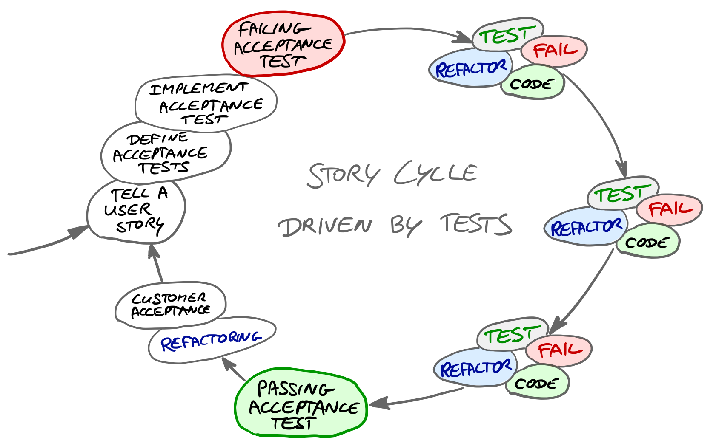

-   **tags:** ATDD - Acceptance Test Driven Development

We often use this diagram from  Lasse Koskela&rsquo;s book Test Driven to explain how the small loops in TDD - Test Driven Development fit into our our overall way of working. Apart from the book, we could not find an online version of this diagram, so we are putting it here, with a brief explanation as we would do this in a [Test Driven Development course](https://www.qwan.eu/training/test-driven-development.html).

Story cycle, as drawn by  Marc Evers.

We use this diagram in [our Test Driven Development course](https://www.qwan.eu/training/test-driven-development.html), to set the stage. While we focus on the test-fail-pass-refactor cycles on the right, having intent developed in close collaboration with stakeholders is not optional.

Let&rsquo;s go to the loop from left to right. In a sense, there is an Outer loop loop, comprised of collaborating with customers, including the Inner loop, where developers move the code forward to the point where we can have a conversation with the stakeholders and ship it. Or in a high-trust environment, developers ship it and have the conversation later.

Nothing stops us from having conversations with the stakeholders all the time. Small, controlled steps help developers be more responsive to users&rsquo; needs. Customer acceptance at the end of the loop is a form of MVC - Minimum Viable Communication.

## Outer loop

### Tell a user story

This is deliberately phrased as **Tell**, not write. We like Ron Jeffries&rsquo; [Card, Conversation, Confirmation](https://ronjeffries.com/xprog/articles/expcardconversationconfirmation/). Developers have a conversation (or more if needed) with the stakeholders. They write things down on index cards or post-its. That is because there can not be much written on a card, it is simple a token for future conversations. 

### Define acceptance criteria / tests

So we sit down with the stakeholder and we ask, and the users, if we can have access to
 the users. We ask them what would it look like when this is done. See Ron Jeffries&rsquo;  [Card, Conversation, Confirmation](https://ronjeffries.com/xprog/articles/expcardconversationconfirmation/) text for more detail.

### Implement acceptance test

We may choose to implement the acceptance test in code, in one form or another. When we model our domain well, these can also be fast running tests, we do not need to spin up a whole application or a set of services to run these. The upside of formalising these tests is that it reveals our lack of understanding quickly and we can have more conversations with the stakeholders.

When we implement these, we do this one at a time, preferably in an order that allows us to ship each one individually.

### Failing acceptance test

Then we have one failing acceptance test. Since we need to go through the inner loop multiple times, we want to have momentum, a constant sense of progress. So for acceptance tesing, we also apply the [TDD Heuristic, One failing test at a time](https://www.qwan.eu/2022/04/13/tdd-one-failing-test-at-a-time.html).

### Inner loop

See Inner loop for details. Here developers create working, sustainable software, one failing test at a time.

### Passing acceptance test

Then we have a passing acceptance test. We celebrate, and let out a sigh of relief. We have something that we can ship. But this is also a good time to step back.

### Take-a-step-back refactoring

In the Inner loop refactoring happens all the time. Now that we have something visible and cohesive from a users&rsquo; perspective, we can take a step back and see if we can improve the cohesiveness of the design from a developers&rsquo; perspective. Our future selves and our colleagues will be grateful for this.

It is also fun, because the pressure to get something done is off, we often gain some more perspective, and can play around with the design, as it is expressed in the code.

### Customer acceptance

We like continuous delivery, so go back to our stakeholders for acceptance as soon as possible. In a high-trust environment we ship immediately, and notify the customer after. In a lower trust environment, or when processes dictate, we will ask for acceptance first. But we rarely wait until the end of an arbitrary time period. Small changes shipped frequently are more reliable, and if we make users (un)happy, we would know rather sooner than later.

### Ship it and on to the next iteration of the loop

Ship it has been mentioned several times, an may have happened already.

You may be familiar with this loop as BDD or ATDD.

## Inner loop

This loop still appears something that is best learnt by doing, so I will keep it brief here. In our training courses we explain the loop briefly, and as we practice through a series of exercises, add [TDD Heuristics](https://www.qwan.eu/blog-by-tag#tag-test-driven-development), rules of thumb, to the board based on what we and the participants observe.

### Write a test

We write [one test](https://www.qwan.eu/2022/04/13/tdd-one-failing-test-at-a-time.html), we apply  Wishful Thinking about the functionality and interface that we want. We look for the smallest step we can take that will move us forward, and teach us something about the design. 

### Make it fail

Then we make the test fail. We inspect the failure message for clarity. Will our future selves understand the message? [Will our colleagues](https://www.qwan.eu/2025/12/12/four-plus-one-rules-of-simple-design.html)?

This step is also important, because some test frameworks occasionally fail to pick up new tests. This keeps us in the loop. Occasionally we find out, especially in larger systems, that the functionality we want already exists. Then it is usually back to the drawing board, there might be more that we can use.

### Make it pass

We take the smallest step forward to make the test pass. We apply [the Faking & Cheating heuristic](https://www.qwan.eu/2021/07/20/tdd-faking-cheating.html). This usually lets us discover some tests that we missed. We add them to the test list, and move on.

### Refactor

We improve naming, remove duplication. We also extract common setups and 

## Further reading

[Emily Bache](https://coding-is-like-cooking.info) calls this way of working  Double Loop TDD her [Double-Loop TDD Learning hour](https://www.sammancoaching.org/learning_hours/bdd/double_loop_tdd.html) has a similar diagram of the cycle, with fewer parts. If you want, you can play &rsquo;spot the difference&rsquo;. I only found her naming of this cycle from 2013 this week, as someone asked a question about it. I structured today&rsquo;s explanation into inner and outer loop - it is easy to outline in a post. In a live setting we tend to work left to right, from &rsquo;tell a story&rsquo; and then go round the circle.

One concrete advice on how to &rsquo;ship it&rsquo;, you can find in [Feature toggles, no thank you, I&rsquo;d rather ship piecemeal](https://www.qwan.eu/2018/04/18/feature-toggle-no-thank-you-ship-piecemeal.html).

Ron Jeffries&rsquo; blog post [Card, Conversation, Confirmation](https://ronjeffries.com/xprog/articles/expcardconversationconfirmation/) goes into more detail on the conversation.

Our earlier post Three feedback loops in software product development, where the left side interacts with the product loop, everything in the story cycle fits in the &rsquo;working together getting things done&rsquo;, and working in small, reversible steps more in the &rsquo;Technical Excellence loop&rsquo;, enabling the other loops to be more agile.

## Call to action:

TDD is simple, but not easy. We can support you and your team(s) to walk, and then run, with TDD. Be it classical or AI augmented. We&rsquo;d love to hear what is going on in your organisation. These practices are all patterns and need adjustment for the context they are applied in. We love doing that. The first conversation is free. <call>
