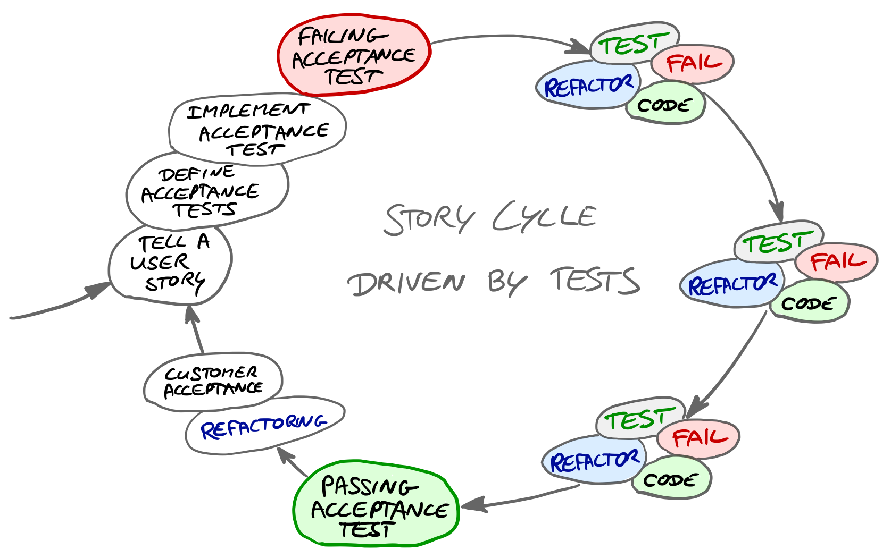

We often use the diagram below to explain how the small loops in TDD (Test 
Driven Development) fit into our overall way of working, [when we write code by hand](#on-writing-code-by-hand). The diagram is a variation on a diagram from  Lasse 
Koskela&rsquo;s [book Test Driven](https://www.manning.com/books/test-driven). 
Apart from the book, we could not find an online version of 
this diagram, so we are putting it here, with a brief explanation as we would do this in our [Test Driven Development 
course](/training/test-driven-development.html).

We use this diagram in our courses to set the stage for TDD. While we focus on the test-fail-pass-refactor cycles on 
the right, having intent developed in close collaboration with stakeholders is not optional.

Let&rsquo;s go through the loop from left to right. In a sense, there is an Outer loop, comprised of collaborating with 
customers, which includes the Inner loop, where developers move the code forward to the point where they can have a 
conversation with stakeholders and ship it. Or in a high-trust environment, developers ship it and have the conversation later.

Nothing stops us from having conversations with the stakeholders all the time. Small, controlled steps help developers be more responsive to users&rsquo; needs. Customer acceptance at the end of the loop is a form of *MVC - Minimum Viable Communication*.

## The outer loop

### Tell a user story

This is deliberately phrased as **tell**, not write. We like Ron Jeffries&rsquo; [Card, Conversation, 
Confirmation](https://ronjeffries.com/xprog/articles/expcardconversationconfirmation/) heuristic. Developers have a 
*conversation* (or more if needed) with the stakeholders. They write things down on index *cards* or post-its. That is 
because not much can be written on a card, so it is simply a token for future conversations. Acceptance tests provide 
*confirmation*.

### Define acceptance criteria & tests

So we sit down with the stakeholders, and ask if we can have access to
 the users. We ask them what would it look like when this is done. See Ron Jeffries&rsquo;  [Card, Conversation, 
Confirmation](https://ronjeffries.com/xprog/articles/expcardconversationconfirmation/) text for more detail.  

### Implement acceptance test

We may choose to implement the acceptance test in code, in one form or another. When we model our domain well, these 
can be fast running tests. We do not need to spin up a whole application or a set of services to run these. Formalising 
these tests will reveal our lack of understanding quickly and trigger more conversations with the 
stakeholders.

When we implement the acceptance tests, we do this one at a time, preferably in an order that allows us to ship each 
one individually.

### Failing acceptance test

Then we have *one* failing acceptance test. Since we need to go through the inner loop multiple times, we want to 
have momentum, a constant sense of progress. So for acceptance testing, we also apply the TDD Heuristic of [One 
failing test at a time](/2022/04/13/tdd-one-failing-test-at-a-time).

### Inner loop

Going through the inner loop multiple times, developers create working, sustainable software, one failing test at a time.
We will describe the inner loop details below.

### Passing acceptance test

Then we have a passing acceptance test. We celebrate, and let out a sigh of relief. We have something that we can ship. 
This is also a good time to step back.

### Take-a-step-back refactoring

In the inner loop, refactoring happens all the time. Now that we have something visible and cohesive from a 
users&rsquo; perspective, we take a step back and see if we can improve the cohesiveness of the design from a developers&rsquo; perspective. Our future selves and our colleagues will be grateful for this.

It is also fun, because the pressure to get something done is off, we often gain some more perspective, and can play around with the design, as it is expressed in the code.

### Customer acceptance

We like continuous delivery, so we go back to our stakeholders for acceptance as soon as possible. In a high-trust 
environment we ship immediately, and notify the customer after. In a lower trust environment, or when processes dictate, we will ask for acceptance first. But we rarely wait until the end of an arbitrary time period. Small changes shipped frequently are more reliable, and if we make users (un)happy, we would know rather sooner than later.

### Ship it and on to the next iteration of the loop

Ship it has been mentioned several times, and may have happened already.

You may be familiar with this loop as Behaviour Driven Development (BDD) or Acceptance Test Driven Development (ATDD).

## The inner loop

This loop is still best learnt by doing, so we will keep it brief here. In our training 
courses we explain the loop briefly, and as we practice through a series of exercises, we share [TDD 
Heuristics](/blog-by-tag#tag-test-driven-development): rules of thumb based on what we and the 
participants observe.

### Write a test

We write [a single test](/2022/04/13/tdd-one-failing-test-at-a-time), we apply [Wishful 
Thinking](/2021/07/01/tdd-wishful-thinking) about the 
functionality and interface that we want. We look for the smallest step will move us forward and that will teach us 
something about the design. 

### Make it fail

Then we make the test fail. We inspect the failure message for clarity. Will our future selves understand the message? [Will our colleagues](/2025/12/12/four-plus-one-rules-of-simple-design)?

This step is also important, because some test frameworks occasionally fail to pick up new tests. This keeps us in the loop. Occasionally we find out, especially in larger systems, that the functionality we want already exists. Then it is back to the drawing board, there might be more that we can use.

### Make it pass

We take the smallest step forward to make the test pass. We apply [the Faking & Cheating 
heuristic](/2021/07/20/tdd-faking-cheating). This often helps discover some tests that we missed. We add them 
to the test list, and move on.

### Refactor

We improve naming, remove duplication. We also extract common setups and ensure the names of the set of tests together read a bit like a specification. 

## On writing code by hand

We wanted to keep the intro short and to the point. [Practices are patterns that work in a context](https://www.qwan.eu/2025/10/06/practices-are-patterns.html) The context in which this cycle works is when we write code by hand. The inner loop works differently when working with AI augmented tools.

We regularly practice hands-off augmented development. We write code by hand to keep ourselves sharp, to push designs where models will not yet go, and when we do our classic TDD course. 

Engineering managers buy these courses when they find that their people need to be able to walk, before they can run, and in environments where the use of AI is not allowed (e.g. government agencies in several countries). The outside loop with fast acceptance tests against a well-designed domain is still very similar, but Large Language Models so far appear to work better writing more tests and code in one go, and doing refactoring separately, guided by experience and deterministic tooling. This could be a whole post, but we hope you get the drift.

## Further reading

[Emily Bache](https://coding-is-like-cooking.info) calls this way of working Double Loop TDD. Her [Double-Loop TDD 
Learning hour](https://www.sammancoaching.org/learning_hours/bdd/double_loop_tdd.html) uses a similar diagram of the 
cycle, with fewer parts. If you want, you can play &rsquo;spot the difference&rsquo;. I only found her naming of this 
cycle from 2013 this week, as someone asked a question about it. I structured today&rsquo;s explanation into an inner 
and outer loop, which makes it easier to outline in a post. In a live setting we tend to work left to right, 
starting from &rsquo;tell a story&rsquo; and then go round the circle.

You can find some concrete advice on how to &rsquo;ship it&rsquo; in [Feature toggles, no thank you, 
I&rsquo;d rather ship piecemeal](/2018/04/18/feature-toggle-no-thank-you-ship-piecemeal).

Ron Jeffries&rsquo; blog post [Card, Conversation, Confirmation](https://ronjeffries.com/xprog/articles/expcardconversationconfirmation/) goes into more detail on the conversation.

Our earlier post [Three feedback loops in software product development](/2023/02/01/development-feedback-loops) 
introduces a feedback loop based perspective. We can map the story cycle on the three feedback 
loops: 
- the left side interacts with the product loop; 
- everything in the story cycle fits in the &rsquo;working together getting things done&rsquo; loop; 
- working in small, reversible steps fits in the technical excellence loop, enabling the other loops to 
  be more agile.

<aside>
<h3>TDD is simple, but not easy</h3>

We can support you and your team(s) to walk, and then run, with TDD. Be it classical or AI augmented. We&rsquo;d love to hear what is going on in your organisation. These practices are all patterns and need adjustment for the context they are applied in. We love doing that. The first conversation is free.

<a href="/contact">Let's have a chat</a>

</aside>
